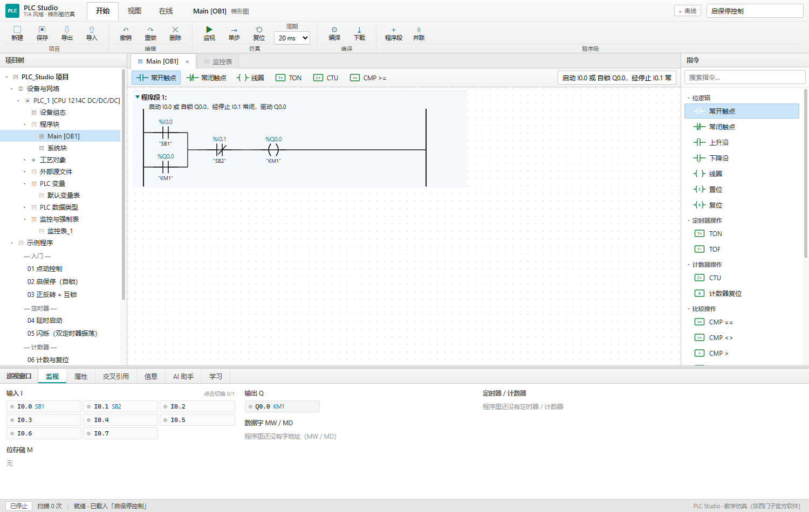
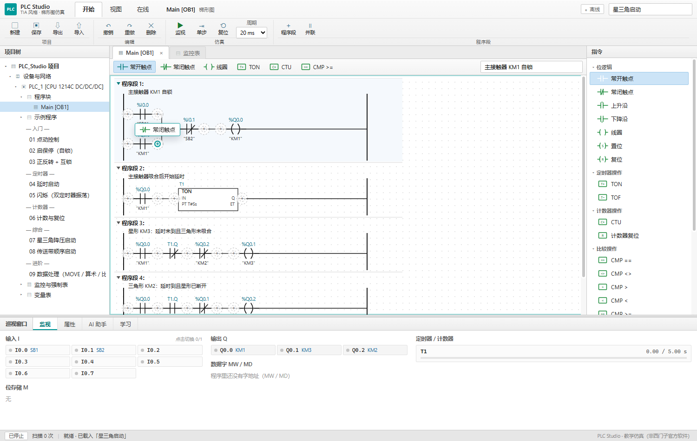

# SuperQi PLC Studio · 博途风格梯形图仿真与学习

一个**本地网页版**的 PLC 梯形图编辑 + 仿真 + 学习工具。界面按**西门子 TIA Portal（博途）**的格式重做：功能区、项目树、指令树、巡视窗口、黑色 LAD 线路 + 青色 `%I0.0` 地址、程序段标题与注释行、在线监视值。
纯前端、零依赖、不联网也能用，程序自动存在浏览器本地。



---

## 1. 快速开始

| 方式 | 操作 | 适合 |
|---|---|---|
| 直接打开 | 双击 **`启动.bat`** | 日常使用，完全离线 |
| 本地服务 | 双击 **`启动-联网模式.bat`**（需要 Python） | 要接大模型 API 时（避免 file:// 的跨域限制） |

`启动.bat` 会**直接调用 Edge**（找不到就找 Chrome），不依赖系统对 `.html` 的默认关联——有些机器把 `.html` 关联到了 IE，而本程序用了现代 JS，IE 打不开，表现就是"双击没反应"。

**如果双击 .bat 仍然没反应**：打开 Edge，把 `index.html` 拖进窗口；或右键 `index.html` → 打开方式 → Microsoft Edge。

> **想发布到公网？** 整套站点是纯静态的，把 `plc-studio` 文件夹原样上传到 Cloudflare Pages / Netlify / GitHub Pages 即可。
> 域名建议、绑定步骤、搜索引擎提交、备案说明都写在 [deploy/README-部署.md](deploy/README-部署.md)。

**30 秒上手**

1. 左侧项目树里点一个示例（`示例程序` → `02 启保停`）
2. 点功能区 **监视**（相当于在线）
3. 在下方巡视窗口的「监视」里点 **I0.0**，看线路和数值变绿
4. 把右侧指令树里的指令**拖到画布上**（也可以点指令后，把鼠标移到导线上、出现 + 时点击）；点元素后到下方「属性」里改地址

---

## 2. 界面布局（对标博途）

```
┌──────────────────────────────────────────────────────────────┐
│ 功能区  开始 | 视图 | 在线        Main [OB1]      离线/在线  │
│ 新建 保存 导出 导入 | 撤销 重做 删除 | 监视 单步 复位 周期   │
├──────────┬────────────────────────────────────┬──────────────┤
│ 项目树    │ Main [OB1]  ×   监控表             │ 指令          │
│ 设备与网络│ ┌ 收藏夹：常开 常闭 线圈 TON …     │ 位逻辑        │
│  PLC_1   │ │ 程序段 1  ← 注释                  │ 定时器操作    │
│  程序块   │ │   ──────── 梯形图 ────────        │ 计数器操作    │
│  示例程序 │ │ 程序段 2 …                        │ 比较/移动/数学 │
├──────────┴────────────────────────────────────┴──────────────┤
│ 巡视窗口   监视 | 属性 | AI 助手 | 学习      （可拖动改高度） │
├──────────────────────────────────────────────────────────────┤
│ 离线 · 扫描 0 次 · 消息                                      │
└──────────────────────────────────────────────────────────────┘
```

**和博途一致的细节**

- **功能区**三个页签：`开始`（项目/编辑/仿真/编译）、`视图`（注释/符号/网格/数值开关）、`在线`（监视/单步/复位/周期）
- **项目树**完整层级：项目 → 设备与网络 → PLC_1 [CPU 1214C DC/DC/DC] → 设备组态 / 程序块（Main [OB1]、系统块）/ 工艺对象 / 外部源文件 / PLC 变量 / PLC 数据类型 / 监控与强制表 / 示例程序 / 在线与诊断，节点可展开收起
- **右侧指令树**按博途分组，带**搜索框**：位逻辑、定时器操作、计数器操作、比较操作、移动操作、数学函数
- **收藏夹**横条在编辑器上方，常用指令一点即选
- **程序段**：`▾ 程序段 1：` + 下一行注释（没写注释时显示灰色「注释」占位），分隔线，选中时浅蓝底
- **LAD 图形**：黑色细母线/连线，触点线圈为黑色符号，地址 `%I0.0` 青色，符号名 `"SB1"` 黑色（和博途一致）
- **在线监视**：连接状态变「在线」，元素上方显示 `TRUE` / `FALSE`，定时器/计数器方框里显示 ET / CV
- **编译**：功能区「编译」做真实结构校验（地址、双线圈、缺停止条件、定时器过小等），结果在「信息」页，点条目跳到对应程序段；「下载」置灰并说明原因
- **交叉引用**：列出每个操作数的读/写位置与类别，点任意一行跳到对应程序段
- **巡视窗口**可上下拖动调整高度，六个页签：监视 / 属性 / 交叉引用 / 信息 / AI 助手 / 学习

**和博途不一样的地方（刻意保留的差异）**：没有多引脚接线（TON 的 IN/PT/Q/ET 是画出来的，不带多路连线）；没有 SCL / FBD / GRAPH 视图、DB / FC / FB、真机在线下载与诊断。

**拖拽**

- 从右侧指令树 / 上方收藏夹把指令拖到画布上，松手即插入；拖动时有跟随预览，目标位会高亮成青色圆圈
- 插入位平时**完全隐藏**（导线上不会出现小圆圈，保持博途那种一条完整直线），鼠标移到导线上才出现 `+`，点击即可插入
- 画布里的元素可以直接拖着走：同支路前后、换支路、换程序段都可以；拖走后留下的空并联分支会自动清理（避免“空分支=直通”的逻辑错误）
- 拖到画布边缘会自动滚动；按 `Esc` 取消本次拖动
- 点选 + 点 **+** 的老方式仍然可用



---

## 3. 功能

### 3.1 梯形图编辑
- 串联 / 并联（并联分支一键生成）、多程序段、程序段注释
- **拖拽**：从指令树拖入、拖动已有元素换位置（详见第 2 节）
- 触点：常开、常闭、上升沿(P)、下降沿(N)
- 输出：线圈、置位(S)、复位(R)
- 指令：TON、TOF、CTU、计数复位、比较、MOVE、算术（ADD/SUB/MUL/DIV）
- 撤销 / 重做、自动保存、JSON 导入导出

### 3.2 仿真
- 真实扫描语义：自上而下逐段、段内自左向右，**指令全部执行不短路**
- 定时器按**真实毫秒**累计（20 ms 周期下 1 s 定时就是 1 s）
- 能流高亮、I/Q/M 状态、ET/PT 进度、CV/PV、MW/MD 可读可写
- 监视 / 停止 / 单步 / 复位，扫描周期 10–100 ms

### 3.3 AI 助手（离线可用，接口已预留）
- **自然语言 → 梯形图**：`按下启动按钮电机运行，按停止按钮停止` → 生成可运行程序
  模板：点动、启保停、正反转互锁、延时、闪烁、计数、顺序启动、星三角、延时报警
- **解释程序**：逐行说明条件与输出，识别自锁 / 互锁 / 定时 / 计数结构
- **体检**：双线圈、只启动不停止、定时器过小、输出没被引用
- **概念问答**：自锁、互锁、双线圈、扫描周期、边沿、TON/TOF、星三角、常开常闭、4–20mA、急停、Modbus、PNP/NPN
- 「API 设置」里可填 DeepSeek / OpenAI 兼容接口，Key 只存本机（浏览器直连可能被 CORS 拦截）

### 3.4 学习关卡
6 关：点动 → 启保停 → 正反转互锁 → 延时 → 计数 → 顺序启动。
**判分是真的跑仿真**：按用例打输入、跑扫描、比对输出，逐条给出通过/失败原因。

---

## 4. 指令与地址

| 类别 | 写法 | 说明 |
|---|---|---|
| 输入 | `I0.0` …（界面显示 `%I0.0`） | 监视面板可点动 |
| 输出 | `Q0.0` … | 只读 |
| 中间位 | `M0.0` … `M127.7` | 可强制 |
| 字地址 | `MW0` `MD0` `MB0` 等 | 大端；MW 按有符号 16 位 |
| 定时器 | `TON T1, PT=2000ms`；触点写 `T1.Q` | 实例名 T1、T2… |
| 计数器 | `CTU C1, PV=3`；触点写 `C1.Q`；复位用 `R C1` | 实例名 C1、C2… |

---

## 5. 与真实 S7-1200 的差异（务必知道）

1. **定时器/计数器是实例名**（`T1`、`C1`），不是 IEC_TIMER 背景数据块。
2. **CTU 的复位是独立指令**（`R C1`），真实 S7-1200 是 CTU 方框上的 R 引脚。
3. 没有 DB / FC / FB / 工艺对象 / 模拟量模块，只有位逻辑 + 基本运算。
4. **扫描不短路**：每个指令每周期都执行，触点断开只是把能流置 0（与真机一致）。
5. **双线圈后写优先**，属性页会告警。
6. 输入无滤波时间，极短脉冲也能采到（真机会丢）。
7. 时间按 `performance.now()` 真实间隔累计，暂停即暂停。

---

## 6. 快捷键

| 按键 | 作用 |
|---|---|
| `空格` | 监视 / 停止 |
| `Del` / `Backspace` | 删除选中元素 |
| `Ctrl+Z` / `Ctrl+Shift+Z` | 撤销 / 重做 |
| `Esc` | 取消选中；拖动中则取消拖动 |

---

## 7. 目录结构

```
plc-studio/
├── index.html            界面骨架（功能区/项目树/编辑器/指令树/巡视窗口）
├── assets/app.css        TIA 风格主题
├── js/core.js            程序模型、地址解析、结构校验、序列化
├── js/runtime.js         扫描引擎（触点/线圈/定时器/计数器/运算）
├── js/render.js          梯形图 → SVG（程序段标题/注释、黑色线路、青色地址、在线值）
├── js/nlp.js             离线 NL→梯形图、解释、诊断、问答
├── js/library.js         示例程序 + 教学关卡（含判分用例）
├── js/ai.js              可选大模型接口（OpenAI 兼容）
├── js/app.js             UI 装配与交互
├── test/run-tests.js     Node 自测（116 项）
├── test/smoke.js         UI 冒烟测试（38 项）
└── docs/screenshot.png
```

---

## 8. 自测

```bash
node test/run-tests.js      # 引擎 / 示例 / 关卡 / 自然语言 / 问答 / 健壮性
python test/make_smoke.py   # 生成 UI 冒烟页，浏览器打开 test/smoke.html 看结果
```

当前：引擎与内容 **116 / 116**，界面冒烟 **38 / 38**。

---

## 9. 二次开发

- **加指令**：`core.js` 的 `ELEMENT_SPEC` + `makeElement` → `runtime.js` 的 `evalElement` → `render.js` 的 `drawBox` → `app.js` 属性面板加字段。
- **加示例**：`library.js` 里 `PROGRAMS.push({ id, name, group, desc, build() {...} })`。
- **加关卡**：`LESSONS.push({ ..., tests: [{ name, steps:[{set,ms}], expect }] })`。
- **改主题**：`assets/app.css` 顶部 CSS 变量（`--teal`、`--lad`、`--sel`…）。

---

## 10. 已知限制

- 只支持"串联-并联"结构（无跨段跳转、跳转指令、子程序）
- 没有 PLCopen TC6 XML 导入导出（需要与 Beremiz/OpenPLC 互通时可加一层转换）
- 没有被控对象动画（电机/气缸/传送带 2D 仿真）
- 指令框为单进单出（PT/R 是画出来的参数，不是接线引脚）；拖拽只支持“插到某个位置”，不支持画任意连线
- 无多用户/云端存储，数据只在当前浏览器


